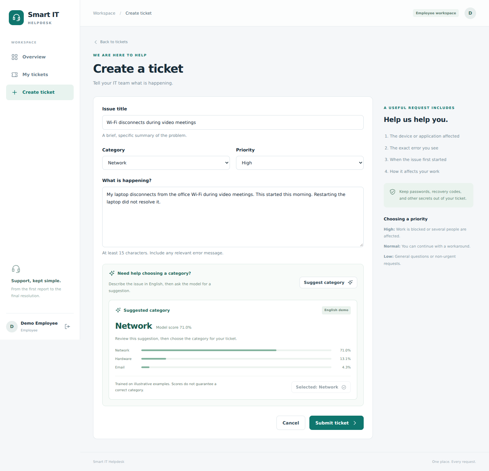
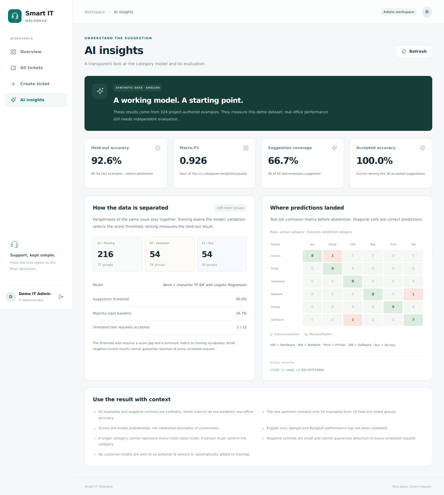
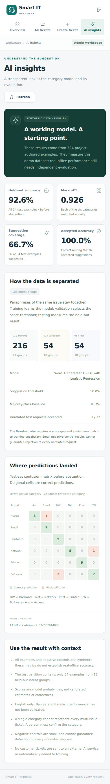

# Smart IT Helpdesk

An AI capstone that brings employee IT requests, administrator workflows and category suggestions into one web application.

**Phase 4 / version 0.4.0:** React + Vite + TypeScript + Tailwind CSS, Python + FastAPI, PostgreSQL, a scikit-learn classifier and document-backed conversations. This is a local development release; a public application deployment has not been completed.

## Problem and proposed solution

IT teams often receive issues through scattered calls, messages and email. Requests lack consistent categories, employees cannot see progress, and administrators repeat triage work. Smart IT Helpdesk provides a central ticket, conversation and status history. An AI model suggests a category while the person submitting the issue keeps the final choice.

The six categories are **Email, Network, Hardware, Software, Printer and Access**. The application does not diagnose devices, run repair commands or automatically grant access.

## Working features

- Employee registration, administrator provisioning, secure sign-in and sign-out.
- PostgreSQL-backed tickets, comments, activity history and dashboard counts.
- Employees see their own requests; administrators can view and manage all requests.
- Status, priority and category filters, search and pagination.
- English ticket-category suggestions with model scores and an explicit **Use category** action.
- Manual selection when a suggestion is uncertain, unsupported or unavailable.
- An immutable AI assessment at ticket creation, stored alongside the person's selected category.
- An administrator **AI insights** page with measured metrics, confusion matrix and limitations.
- Administrator PDF/TXT upload, extracted-text preview, activation and removal.
- **Ask helpdesk** searches active documents and returns matching passages with source links.
- Private conversations saved in PostgreSQL, including protection against duplicate network retries.
- Document deactivation/removal also hides its quotations in earlier chat responses.
- Responsive desktop and mobile layouts.

## Setup

**Already running Phase 2 or 3?** Follow [Phase 4 Windows upgrade](docs/PHASE4_SETUP.md).

**First installation?** Install Python 3.11, Node 22.12+ and PostgreSQL 17, then follow [Windows setup](docs/WINDOWS_SETUP.md) for database and administrator creation. Exact dependencies are recorded in the lockfiles.

From Windows PowerShell, backend:

```powershell
& {
    $ErrorActionPreference = "Stop"
    Set-Location "D:\Projects\SmartITHelpdesk\backend"
    if (-not (Test-Path ".\.venv\Scripts\python.exe")) {
        python -m venv .venv
        if ($LASTEXITCODE -ne 0) { throw "Environment creation failed." }
    }
    .\.venv\Scripts\python.exe -m pip install -r requirements.txt
    if ($LASTEXITCODE -ne 0) { throw "Package installation failed." }
    .\.venv\Scripts\python.exe -m app.setup_local
    if ($LASTEXITCODE -ne 0) { throw "Database setup failed." }
    .\.venv\Scripts\python.exe -m uvicorn app.main:app --reload --host 127.0.0.1 --port 8000
}
```

In another PowerShell, frontend:

```powershell
& {
    Set-Location "D:\Projects\SmartITHelpdesk\frontend"
    npm.cmd ci
    if ($LASTEXITCODE -ne 0) { throw "Frontend installation failed." }
    npm.cmd run dev
}
```

Open <http://127.0.0.1:5173>. Use this hostname consistently. The Vite proxy forwards `/api` to FastAPI on port 8000. API documentation is at <http://127.0.0.1:8000/docs>.

The local setup helper keeps an existing `backend/.env`, applies pending Alembic migrations and keeps the existing administrator. On first use it creates a dedicated non-superuser database account and asks for administrator details. Application secrets are ignored by Git.

## Try the AI workflow

1. Sign in and choose **Create ticket**.
2. Title: `Unable to connect to office Wi-Fi`.
3. Description: `My laptop cannot connect to the office wireless network. The Wi-Fi connection fails every time.`
4. Click **Suggest category**. Review the score and choose **Use Network**, or select another category yourself.
5. Submit the ticket. The detail page shows the AI assessment and category selected at submission.
6. As administrator, change the category or status. The event history records the change; the original AI assessment stays intact.
7. Open **AI insights** as administrator to inspect the evaluation.

Changing the title or description clears an earlier suggestion. The server recomputes the assessment from the submitted text, so stale or client-forged predictions are not stored. Existing Phase 2 tickets remain readable with no fabricated historical AI result.

## Try document-backed chat

1. Sign in as administrator and open **Knowledge**.
2. Set the title to `Demo IT Support Guide` and upload [the included demo TXT file](docs/examples/IT_Helpdesk_Demo_Guide.txt).
3. Open **View passages** to inspect the extracted text.
4. Open **Ask helpdesk** and ask `How do I troubleshoot a Wi-Fi connection?`.
5. Follow the document-title link in the response to its highlighted source passage.
6. Refresh the page to confirm that your conversation is saved.
7. Ask an unrelated question, such as `How do I bake a chocolate birthday cake?`, to see the no-match response.

The included guide is illustrative content, not an approved company policy. Active documents are readable by all signed-in users. Only administrators manage documents; every account, including administrators, can read only its own conversations.

**This is extractive document search, not an LLM-generated answer.** Word/character TF-IDF ranks passages; replies quote the matching text. Each question is searched independently. No API key, paid AI service or external document upload is involved. The app does not translate, perform OCR or validate the correctness of an uploaded policy. See [knowledge methodology, permissions and limits](docs/KNOWLEDGE_METHOD.md).

## Demo screenshots

These Phase 3 captures show the category workflow and use seeded **Demo Employee** and **Demo IT Admin** accounts and illustrative ticket text. Phase 4 also adds Ask helpdesk and Knowledge navigation. Model metrics describe the synthetic evaluation dataset, not measured real-office performance.

**Create a ticket and explicitly apply a category suggestion:**



**Administrator AI insights on desktop:**



<details>
<summary>View AI insights on mobile</summary>



</details>

## AI methodology and results

The bundled dataset contains **324 synthetic English examples**, grouped into **108 issue intents**. It was generated for this capstone; it is not a collection of real employee tickets and its labels have not undergone independent human review.

Word and character TF-IDF features feed a Logistic Regression classifier. Whole intent groups are divided into 216 training, 54 validation and 54 test examples. Vocabulary and IDF are fitted on training data only. Validation chooses an abstention threshold; test examples are never used to fit the model or choose the threshold.

| Held-out synthetic test metric | Observed result |
| --- | --- |
| Accuracy before abstention | 50 / 54 = 92.59% |
| Macro-F1 | 0.9255 |
| Suggestion coverage | 36 / 54 = 66.67% |
| Correct among accepted suggestions | 36 / 36 |
| Majority-class baseline | 16.67% |
| Unrelated test requests incorrectly accepted | 1 / 12 |

**These small synthetic results do not establish real-office accuracy.** Scores are not calibrated confidence guarantees. Bangla and Banglish have not been validated. A person confirms every category.

The model fits once per backend process from the bundled training partition. It requires no paid API, external AI service or downloaded model pickle. See the [model card](docs/MODEL_CARD.md), [dataset provenance](backend/data/README.md) and [evaluation evidence](docs/evaluation/README.md).

To reproduce evaluation without a database:

```powershell
Set-Location "D:\Projects\SmartITHelpdesk\backend"
.\.venv\Scripts\python.exe -m app.train_classifier
```

This writes `backend/evaluation/report.json`, `split_manifest.json`, `test_predictions.csv` and `confusion_matrix.csv`. Local output is ignored by Git. The administrator page calculates the same report from the running model.

## Project structure

| Location | Purpose |
| --- | --- |
| `frontend/src/` | React application and responsive UI |
| `backend/app/main.py` | Authenticated API and ticket workflow |
| `backend/app/classifier.py` | Grouped splits, fitted pipeline, abstention and metrics |
| `backend/app/train_classifier.py` | Reproducible evaluation export |
| `backend/app/knowledge_api.py` | Document management, private conversations and source visibility |
| `backend/app/documents.py`, `pdf_worker.py` | Validated upload, bounded PDF extraction and chunking |
| `backend/app/retrieval.py` | Local TF-IDF passage ranking and no-match behavior |
| `backend/data/` | Synthetic examples, negative controls and provenance |
| `backend/alembic/` | Versioned database migrations |
| `backend/tests/` | Model, authorization and persistence regression tests |
| `docs/` | Setup, architecture, methodology and observed verification |

## Verification

Forty automated tests passed, including the original account/ticket/classifier checks, real PDF extraction, upload limits, private chat isolation, exact citations, duplicate retry handling and source revocation. Production frontend build and browser workflows passed. Migrations preserve earlier accounts and tickets. See [Phase 4 verification details and limits](docs/PHASE4_VERIFICATION.md) and [Phase 3 evidence](docs/VERIFICATION.md).

To run database-free tests:

```powershell
& {
    Set-Location "D:\Projects\SmartITHelpdesk\backend"
    .\.venv\Scripts\python.exe -m pip install -r requirements-dev.txt
    if ($LASTEXITCODE -ne 0) { throw "Test dependency installation failed." }
    .\.venv\Scripts\python.exe -m pytest tests/test_classifier.py tests/test_documents.py tests/test_retrieval.py -q
}
```

Integration tests additionally require `TEST_DATABASE_URL` for a disposable PostgreSQL database. They create a randomly named schema and remove only that schema. Without this explicit setting integration tests are skipped, not counted as passing.

## Remaining capstone work

- Independent label review and permissioned, anonymized real-ticket evaluation.
- Independent retrieval evaluation using representative, permissioned IT guides and questions.
- Bangla/Banglish evaluation if those languages are included in the final claim.
- Free-host deployment, production configuration and a verified live URL.
- A final report covering the completed application, results and limitations.

The repository records real implementation commits. No earlier development history or deployment result is invented. Public deployment still needs HTTPS, secure cookies, exact allowed origins, an appropriate registration policy and shared request limits. Authentication details are documented in [architecture](docs/ARCHITECTURE.md).
