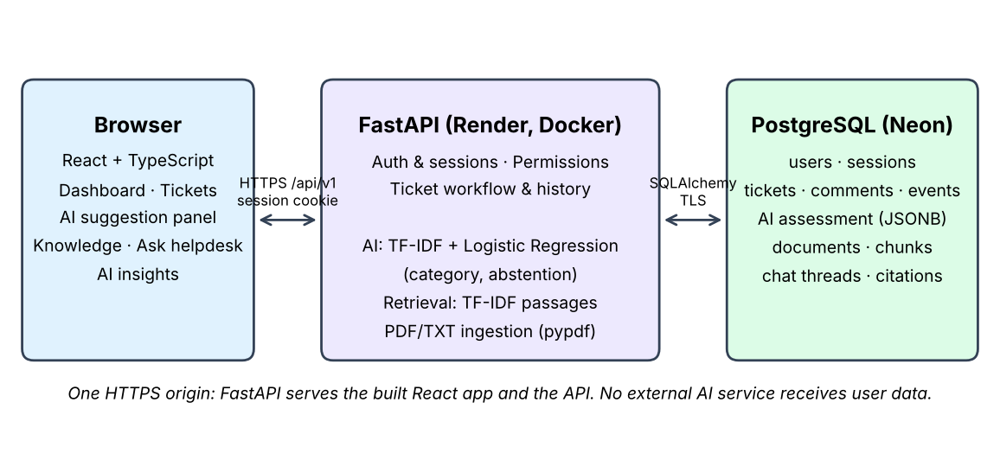
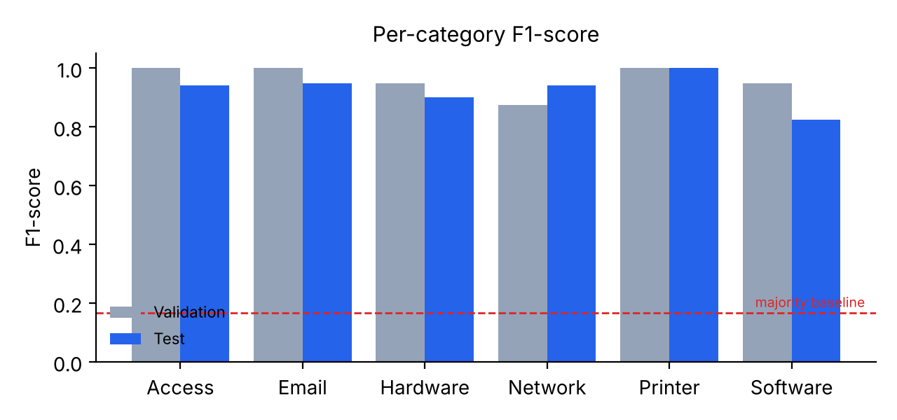
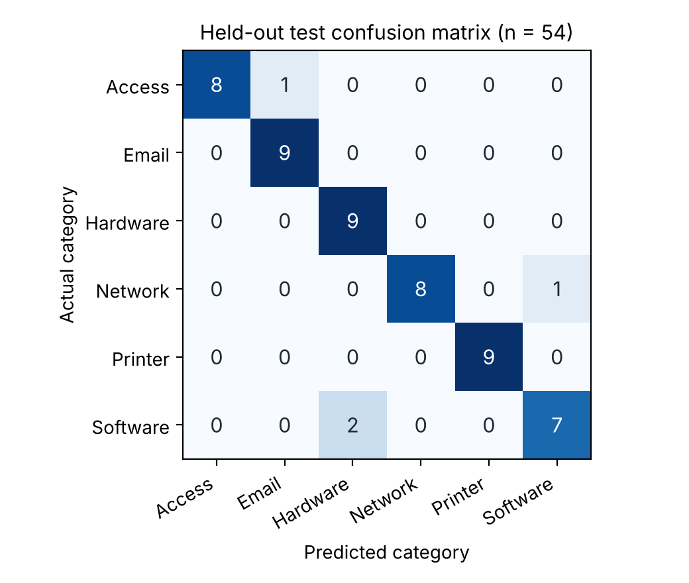

**Live application:** <https://smart-it-helpdesk-hdw5.onrender.com/>\
**Source code:** <https://github.com/skmdsaadi/SmartITHelpdesk>

## 1. Problem solved

Workplace IT support often runs on phone calls and chat messages. Requests have no consistent category, employees cannot see progress, the IT team repeats triage work, and answers that already exist in IT guides are hard to find. Smart IT Helpdesk replaces this with one web application in which:

- every issue becomes a **ticket** with an owner, priority, status, replies and an audit history;
- an **AI classifier suggests the category** of a new ticket, and the person decides whether to use it;
- administrators upload **IT guides**, and employees **ask questions** that are answered with quoted passages and source links.

All three objectives in the proposal were delivered and deployed publicly on free hosting.

## 2. System design

{width=95%}

**Frontend.** A React + TypeScript single-page app built with Vite and styled with Tailwind CSS. Screens: sign-in/registration, dashboard counts, ticket list with search/filters/pagination, ticket creation with an AI suggestion panel, ticket detail (conversation, history, AI assessment), Knowledge library, Ask helpdesk chat, and an administrator AI insights page. The layout is responsive and was checked at a 390 × 844 mobile size.

**Backend.** FastAPI with Pydantic validation and SQLAlchemy 2.0. The API (`/api/v1`) covers accounts, tickets, comments, AI classification, model reporting, documents and chat. Alembic migrations version the schema.

**Database.** PostgreSQL stores users, hashed sessions, tickets, comments, ticket events, the creation-time AI assessment (JSONB), documents, extracted passages, chat threads, turns and citations. Check constraints and foreign keys enforce valid categories, statuses and references.

### Key design decisions

| Decision | Reason |
| --- | --- |
| Human confirms every AI category | A wrong category delays support; the model assists rather than decides |
| Model **abstains** when unsure | A visible "please choose" is safer than a confident wrong suggestion |
| Classical ML instead of an LLM API | Runs within 512 MB on a free server, costs nothing, is explainable and keeps ticket text private |
| Extractive retrieval instead of generated answers | Answers quote the approved guide exactly, so the system cannot invent IT instructions |
| Server recomputes the AI assessment at submission | A client cannot forge or reuse a stale prediction |
| Optimistic locking (version column, HTTP 409) | Two administrators cannot silently overwrite each other's edits |
| Argon2 hashes + opaque HttpOnly sessions + origin checks | Standard protection against password theft, token leakage and cross-site requests |
| One Docker service serving UI and API | One HTTPS origin, simpler cookies and CORS, fits Render Free |
| Separate branch and pull request per phase | Each feature is reviewed and traceable in GitHub |

### Error handling and robustness

Hidden and unknown tickets both return 404, so IDs cannot be probed. Invalid input returns 422, missing sign-in 401, denied administrator actions 403, and rate limits 429. Database failures return a clear message instead of a stack trace. If the model or its data cannot load, the UI falls back to manual category selection, and ticket submission keeps working. Uploads are validated by their actual bytes, size-limited (2 MiB, 50 PDF pages), and parsed in a time-limited child process. Chat requests carry an idempotency key, so a network retry cannot create duplicate answers.

## 3. AI workflow

### 3.1 Ticket category classifier

**Data.** 324 English example tickets written for this project, balanced at 54 per category (Email, Network, Hardware, Software, Printer, Access). Each underlying issue (for example "DNS failure") has three paraphrases, giving 108 *intent groups*. A further 30 unrelated texts serve as negative controls.

**Leakage-safe splitting.** Whole intent groups are assigned to train (216), validation (54) or test (54), stratified by category with a fixed seed. Paraphrases of one issue never appear on both sides of a split, which would otherwise inflate accuracy. TF-IDF vocabulary and IDF weights are fitted on training data only.

**Model.** A scikit-learn pipeline joins two feature sets:

- word TF-IDF — unigrams and bigrams, sublinear term frequency, English stop words, up to 12,000 features;
- character TF-IDF — 3–5 character n-grams within words, up to 18,000 features. These features tolerate typos such as "pasword" or "wifi".

A multinomial Logistic Regression (`C = 4`) produces a score for each category.

**Abstention policy.** A suggestion is withheld when the text is too short, uses an unsupported script, is not similar enough to any training example (cosine < 0.12), when the top two scores are within 0.10, or when the top score is below a threshold. The threshold was chosen **on validation data only**: the value with the highest coverage that kept accepted-suggestion accuracy ≥ 90% and accepted no negative control. The selected threshold is 0.50.

**Integration.** While creating a ticket, the user clicks *Suggest category* (`POST /api/v1/ai/classify`), sees the predicted category with its model score, and can press *Use Network* or choose another category. On submission the server recomputes the assessment and saves it, with the model version and timestamp, next to the category the person chose. Administrators can later change the category; the original AI assessment is kept for audit. The *AI insights* page shows the live evaluation report.

### 3.2 Knowledge retrieval (Ask helpdesk)

Administrators upload PDF or TXT guides. Text is extracted with pypdf, split into passages of up to 1,000 characters (120-character overlap), and kept with the page number. A question is scored against active passages as `0.8 × word-TF-IDF cosine + 0.2 × character-TF-IDF cosine`. Up to three passages are returned only if they score at least 0.18, share at least two meaningful words with the question and are within 55% of the best match; otherwise the user is told no matching passage was found and is invited to open a ticket. Each answer links to its highlighted source passage, and deactivating a document hides it from earlier answers too.

## 4. Results

### 4.1 Classifier evaluation (held-out test set)

| Metric | Validation | Test |
| --- | ---: | ---: |
| Accuracy before abstention | 96.30% (52/54) | **92.59% (50/54)** |
| Macro-F1 | 0.962 | **0.926** |
| Suggestion coverage | 83.3% (45/54) | 66.7% (36/54) |
| Accuracy of accepted suggestions | 100% (45/45) | 100% (36/36) |
| Unrelated requests wrongly accepted | 0/12 | 1/12 |
| Majority-class baseline | 16.67% | 16.67% |

{width=80%}

{width=55%}

**Error analysis.** There were four test errors: a DNS problem predicted as Software, an authenticator-phone problem predicted as Email, and two Windows/operating-system problems predicted as Hardware. These are genuinely ambiguous boundaries, since an OS fault on a laptop can reasonably be read as either category. The abstention policy withheld **all four** wrong predictions, so users never saw an incorrect suggestion. The cost is coverage: 14 correct predictions were also withheld, and those users chose the category manually. One unrelated request passed the filter, which shows that out-of-domain rejection is good but not complete.

### 4.2 Retrieval checks

With the included demo IT guide, seven illustrative questions (for example "How do I troubleshoot a Wi-Fi connection?") returned the expected passage first. Four unrelated or vague questions (for example about baking a cake) correctly returned no match. These are acceptance checks, not an independent benchmark.

### 4.3 Software quality and deployment

- **55 automated tests passed**, covering accounts, permissions, tickets, the classifier, PDF extraction, chat privacy, exact citations, retry handling, source revocation and deployment start-up and security.
- The production build was tested in a browser through a local HTTPS proxy with secure cookies, including the mobile layout.
- The system runs on **Render Free** (Docker, Singapore region) with **Neon Free PostgreSQL**. On first start it applies migrations and creates the administrator from environment variables. `/healthz` serves Render's health checks without waking the database.

## 5. Insights

1. **Honest evaluation matters more than a high number.** A plain random split would have mixed paraphrases across train and test and inflated accuracy. Grouped splitting gives a lower but believable 92.6%.
2. **Abstention turns accuracy into trust.** Raw accuracy was 92.6%, but every suggestion shown to a user in testing was correct. For a helpdesk, a missing suggestion is cheaper than a wrong one.
3. **Simple models fit real constraints.** TF-IDF + Logistic Regression trains in seconds, runs within 512 MB, needs no API key and keeps employee text in-house — all important for an organisation in Bangladesh adopting AI on a small budget.
4. **Retrieval should quote, not invent.** For IT procedures, a verbatim passage with a source link is more trustworthy than a fluent generated answer.

## 6. Limitations

- Training and test data are synthetic and written by the developer; real-office accuracy is not yet measured, and labels have not been independently reviewed.
- English only; Bangla and Banglish are not validated.
- Retrieval thresholds are hand-set and not independently benchmarked.
- The free tier sleeps after 15 minutes idle, so the first request can take about a minute.
- Rate limits are held in memory; email verification and password recovery are not implemented.

## 7. Conclusion and future work

Smart IT Helpdesk solves a concrete workplace problem with a complete, deployed full-stack system: a React interface, a secure FastAPI and PostgreSQL backend, and two AI components integrated into the everyday workflow — a category classifier that knows when not to answer, and a source-backed knowledge search. On held-out data the classifier reached 92.6% accuracy and 0.926 macro-F1 against a 16.7% baseline, and none of its accepted suggestions were wrong.

Next steps are to (1) collect an anonymized, permissioned set of real tickets and re-evaluate; (2) add priority prediction and Bangla/Banglish support with multilingual embeddings; (3) optionally summarize retrieved passages with an LLM while keeping citations; and (4) add notifications, shared rate limits and backups for production use.

## References

- scikit-learn: text feature extraction, pipelines, and common pitfalls (data leakage). <https://scikit-learn.org>
- FastAPI documentation. <https://fastapi.tiangolo.com>
- pypdf text extraction. <https://pypdf.readthedocs.io>
- Render Free and Neon Free documentation. <https://render.com/docs/free>, <https://neon.com/docs>
- Project documents: `docs/MODEL_CARD.md`, `docs/KNOWLEDGE_METHOD.md`, `docs/ARCHITECTURE.md`, `docs/evaluation/`.
